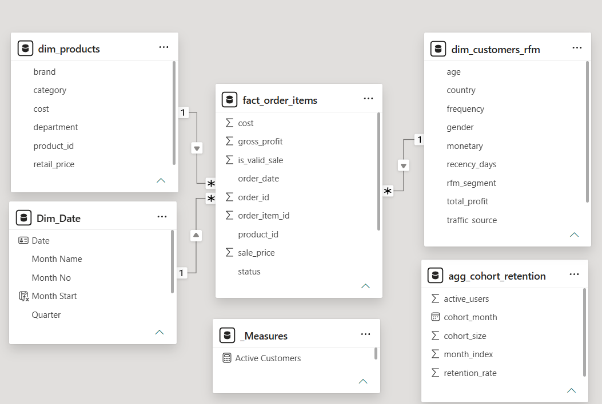
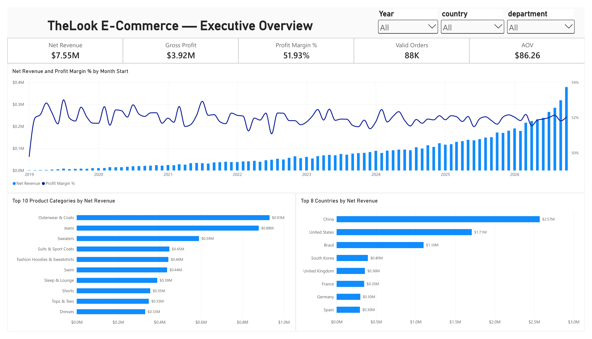
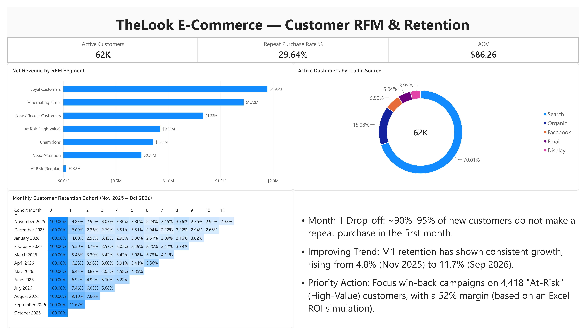
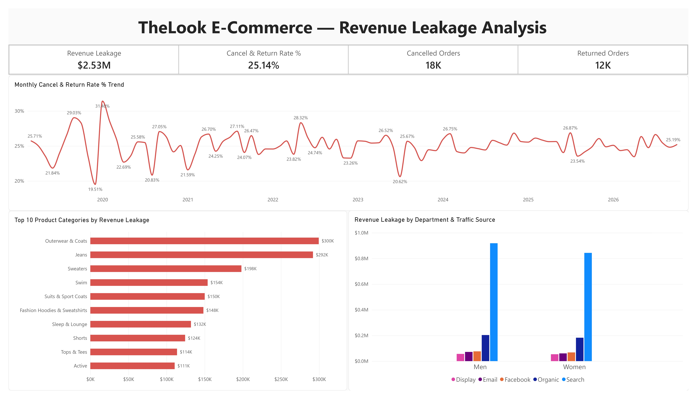
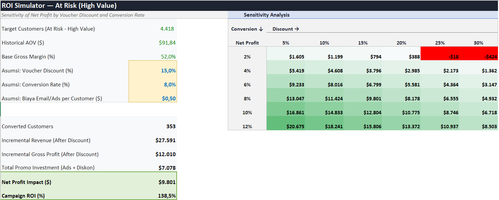

# TheLook E-Commerce: Revenue Leakage, RFM Segmentation & Retention Analytics

An end-to-end Business Intelligence and Customer Analytics project analyzing **87,505 valid orders** and **62,400 active customers** from *TheLook E-Commerce* dataset (Google BigQuery, cutoff date: October 31, 2026). This project diagnoses revenue leakage, evaluates customer retention cohorts, models win-back campaign ROI, and delivers an interactive 3-page executive dashboard.

---

## Business Problem & Objectives
1. **Revenue & Margin Visibility:** Track historical sales growth, gross profit margin, and top-performing markets and product categories.
2. **Customer Retention & Value:** Segment customers using RFM analysis and measure 12-month cohort retention to identify churn patterns.
3. **Revenue Leakage Audit:** Quantify financial losses driven by cancelled and returned orders across categories, departments, and traffic sources.
4. **Actionable Campaign Modeling:** Build a dynamic sensitivity simulator to estimate the financial ROI of targeted retention promotions.

---

## Tech Stack & Architecture
* **Data Warehouse & Transformation (Google BigQuery / SQL):** Data auditing, window functions (`NTILE`, `DATE_DIFF`, `DATE_TRUNC`), CTEs, and Star Schema SQL Views (`fact_order_items`, `dim_products`, `dim_customers_rfm`, `agg_cohort_retention`).
* **Financial Modeling & Ad-Hoc Analytics (Microsoft Excel):** Power Query (locale-safe ETL), Cohort Retention Heatmap, RFM Economics Pivot Table with Slicers, and a 36-scenario What-If Data Table ROI Simulator.
* **BI Modeling & Visualization (Power BI Desktop):** Direct BigQuery Import, Star Schema modeling with custom `Dim_Date`, dedicated `_Measures` DAX table, and a 3-page interactive executive dashboard.

---

## Key Executive Findings

### 1. Sales & Profitability Overview
* Generated **$7.55M in Net Revenue** and **$3.92M in Gross Profit**, maintaining a strong and stable **51.93% Profit Margin** with an **$86.26 AOV**.
* **China, the United States, and Brazil** drive the largest share of revenue, led by *Outerwear & Coats*, *Jeans*, and *Sweaters*.

### 2. Customer RFM & Cohort Retention
* **Repeat Purchase Rate stands at 29.64%**, with *Loyal Customers* ($1.95M) and *Hibernating / Lost* ($1.72M) representing the largest historical revenue pools.
* **Month-1 Drop-off vs. Improving Trend:** While ~90%–95% of new buyers do not repeat in Month 1, M1 retention has improved steadily from **4.8% (Nov 2025)** to **11.7% (Sep 2026)**.

### 3. Revenue Leakage Diagnosis
* **25.14% of all orders** were either cancelled (~18K orders) or returned (~12K orders), resulting in **$2.53M in Revenue Leakage**.
* Leakage rates remain consistently elevated (~25%) over time, concentrated heavily in high-ticket categories (*Outerwear & Coats* at $300K and *Jeans* at $292K) and the *Search* acquisition channel.

### 4. Win-Back Campaign ROI Simulation (Excel)
* Targeting **4,418 *At Risk (High Value)* customers** (historical AOV **$91.84**, base margin **52.0%**) with a **15% voucher discount**, **8% expected conversion rate**, and **$0.50/customer** outreach cost yields:
  * **353 Converted Customers**
  * **$27,591 Incremental Revenue** (post-discount)
  * **$9,801 Net Profit Impact** (**138.5% Campaign ROI**)
* **Sensitivity Analysis (36 Scenarios):** Across 5%–30% discounts and 2%–12% conversion rates, the campaign remains profitable in **34 out of 36 scenarios**, only turning negative if conversion drops to 2% at 25%–30% discount levels.

---

## Strategic Recommendations
1. **Launch Targeted Win-Back Campaign:** Prioritize the 4,418 *At Risk (High Value)* segment with a 10%–15% tiered voucher cap to protect gross margin while capturing high-ROI repeat orders.
2. **Audit High-Leakage Categories:** Investigate sizing accuracy, fulfillment delays, and product descriptions for *Outerwear & Coats* and *Jeans* to curb the 25.14% cancel/return rate.
3. **Capitalize on M1 Retention Momentum:** Replicate recent onboarding or promotional changes that lifted M1 retention from 4.8% to 11.7% across newer cohorts.

---

## Repository Contents
* `/sql` – BigQuery SQL scripts for data auditing, RFM scoring, cohort retention, and Star Schema views.
* `/excel` – Interactive Excel workbook with Power Query connections, Cohort Heatmap, RFM Pivot Table, and What-If ROI Simulator.
* `/powerbi` – Full `.pbix` file and static `.pdf` executive export.
